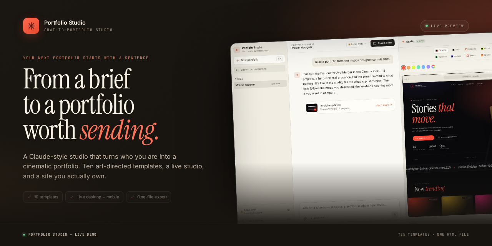
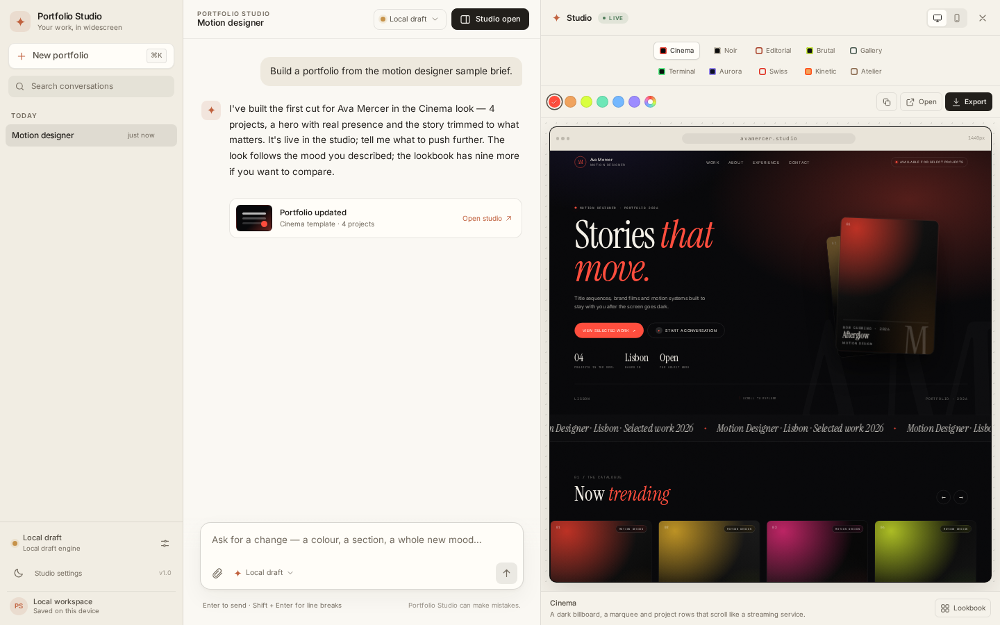
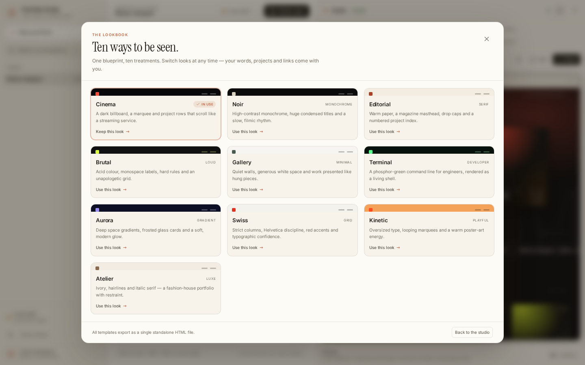
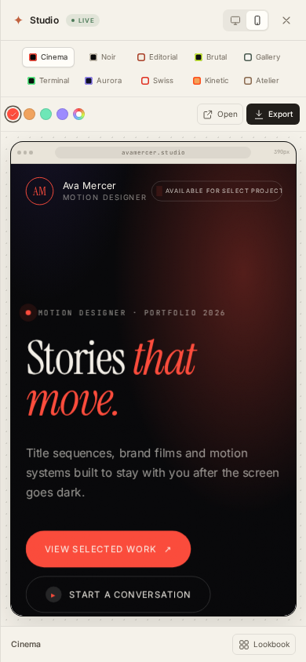
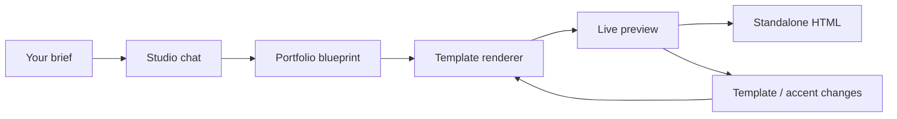

<div align="center">



# Portfolio Studio

**Turn who you are into a portfolio worth sending.**

A Claude-style studio that interviews you, art-directs the result, and hands you a portfolio you own.
Ten cinematic templates, a live desktop + mobile preview, one-file HTML export, and an optional
Google sign-in + Stripe subscription layer for running it as a product — including a private
sign-in wall, a 14-day trial portfolio clock, and Pro-only downloads.

[**Live demo**](https://site-12814198e9224ea9861b511f69be1706.freebuff.page) · [Features](#the-studio) · [Templates](#ten-templates-one-blueprint) · [Quick start](#quick-start) · [Deploy](#build-and-deploy)

[](https://site-12814198e9224ea9861b511f69be1706.freebuff.page)
[](https://github.com/uchejerla/portfolio-llm-project/actions/workflows/ci.yml)
[](https://react.dev)
[](https://www.typescriptlang.org)
[](https://workers.cloudflare.com)
[](#accounts-trial-and-billing)

</div>

---

> **Try it now:** [open the live studio](https://site-12814198e9224ea9861b511f69be1706.freebuff.page). The hosted demo is intentionally running without a model key, so you can explore the complete interface in **local draft mode**. Accounts and subscriptions are also off on that deployment until Google and Stripe keys are added. Run it locally with your own keys for free-form writing and a working trial flow.

## Why this exists

Most portfolio builders start with a grid and a template. This one starts with a conversation.

Tell the studio who you are, what you make, and which work matters. It writes a point of view, structures your projects, and renders a finished site — then lets you change the look without rewriting a word. No page builder, no blank canvas, no lorem ipsum.

- **Designed, not generated.** Every template is a hand-built front-end with its own type system, layout, motion, and poster art.
- **Your copy stays yours.** The model returns a structured blueprint, not raw HTML. Switching from Cinema to Atelier keeps every word in place.
- **Works without a key.** The local draft engine gets you from a brief to a real starter portfolio; Claude takes it further.
- **A site you own.** Export one standalone HTML file and put it anywhere.
- **A product if you want one.** Google sign-in, a private studio wall, a no-card trial, 14-day trial portfolios, and Stripe subscriptions are already wired in — or switch billing off and self-host it open.

## The studio

Chat on the left. The portfolio assembles on the right.



The studio combines a conversational editor with a live artifact panel:

**Conversation**
- Streaming replies, markdown, stop generation, and a thinking state
- Conversation history, local search, and `⌘K` for a new chat
- Four sample briefs and a fill-in-the-blanks story scaffold
- Attach briefs or résumés as `.txt`, `.md`, `.json`, or `.csv` files
- Google sign-in, a live trial countdown, and a `Studio pass` account menu
- Light and dark themes, responsive layouts, and saved conversations

**Studio**
- Desktop and phone previews that update as the portfolio changes
- Ten templates in a single click, plus a visual lookbook
- Six curated accent colours and a custom colour picker
- Copy the blueprint JSON, open the export in a new tab, or download it
- Ten templates share one content model, so nothing gets lost when you change your mind

**Under the hood**
- Anthropic Claude streaming via the Messages API
- Any OpenAI-compatible chat completions endpoint as an alternative
- Google OAuth with opaque, hashed server sessions — no auth vendor
- Stripe Checkout, billing portal, and signed webhooks for subscriptions
- Server-only model, OAuth, and Stripe keys, with graceful local draft fallback
- A typed normalizer that makes every word of model output render-safe
- A Cloudflare Workers build of the same API for public hosting

## Ten templates, one blueprint

Every portfolio starts as a complete JSON blueprint: identity, hero, projects, about, skills, experience, contact, and links. The renderer turns that blueprint into one of ten art-directed systems.



| Template | Direction | Best for |
| --- | --- | --- |
| **Cinema** | Dark billboard, marquee, horizontal project rows | Filmmakers, motion designers, directors |
| **Noir** | High-contrast monochrome, filmic credits | Photography, editorial, moody personal work |
| **Editorial** | Warm paper, magazine masthead, numbered index | Writers, strategists, consultants |
| **Brutal** | Acid accents, hard rules, monospace labels | Brand designers, studios, culture-led work |
| **Gallery** | Quiet walls, captions, generous white space | Photographers, artists, architects |
| **Terminal** | Phosphor-green shell, command-line rhythm | Engineers, technical founders, developer tools |
| **Aurora** | Deep gradients, frosted glass, soft light | Product designers, AI, modern software |
| **Swiss** | Strict grid, Helvetica discipline, red accents | Designers, architects, typographers |
| **Kinetic** | Oversized type, poster energy, looping marquees | Creative studios, streetwear, culture |
| **Atelier** | Ivory, hairlines, italic serif, quiet luxury | Fashion, luxury, craft-led practices |

All ten are responsive and export with inline CSS, generated poster artwork, and a small scroll-reveal script. Exports load their display fonts from Google Fonts, with system fallbacks.

## Responsive by default

The studio is designed to be edited from a laptop and checked from a phone. The portfolio preview switches between a 1440px desktop canvas and a 390px phone without leaving the page.

<p align="center">
  
</p>

## How it works



1. **Talk.** Describe your practice, paste a résumé, or start from a sample brief. The studio asks only for what it needs.
2. **Structure.** The model returns a complete blueprint: a headline with a point of view, concretely written projects, an about section, links, and a clear call to action.
3. **Art-direct.** Pick a template and an accent. The same words are re-rendered instantly, so comparing looks costs nothing.
4. **Ship.** Export a single HTML file, copy the blueprint, or open the finished site and keep editing.

The blueprint is normalized on the server and again in the browser. Unknown fields, oversized strings, unsafe URLs, and malformed model output are dropped or repaired before anything renders.

## Quick start

**Requirements:** Node.js 20+ and npm.

```bash
git clone https://github.com/uchejerla/portfolio-llm-project.git
cd portfolio-llm-project
npm install
npm run dev
```

Open **http://localhost:3000**.

That is enough to try the whole product. Without a model key the status pill reads **Local draft** and the local engine builds a starter portfolio from your brief. Accounts are off by default; read [Accounts, trial and billing](#accounts-trial-and-billing) to turn them on. With Google keys configured, the studio becomes private: signed-out visitors see only the sign-in wall.

## Connect a model

Create a `.env` file and add an Anthropic key:

```bash
cp .env.example .env
```

```dotenv
ANTHROPIC_API_KEY=your_key_here
ANTHROPIC_MODEL=claude-sonnet-4-5
```

Restart `npm run dev`. The status chip switches to Claude and replies become fully generated.

To use an OpenAI-compatible endpoint instead:

```dotenv
OPENAI_API_KEY=your_key_here
OPENAI_BASE_URL=https://api.openai.com/v1
OPENAI_MODEL=gpt-4.1-mini
```

Anthropic is used when both are configured. Keys are read only by the server; they are never sent to the browser, included in chat storage, or committed. `.env` is gitignored.

Without a key, **local draft mode** can assemble a starter portfolio, extract projects from a brief, change templates and colours, and update your details. It cannot rewrite prose.

## Accounts, trial and billing

Portfolio Studio ships with an optional paid layer. It is **off by default** — add Google and Stripe keys to turn it on, or leave them out and self-host the studio open.

**The model**

- Sign in with Google. No passwords, no magic links, no auth vendor.
- When Google keys exist, the studio is walled: the workspace does not render, and `/api/chat` refuses requests, until the visitor signs in.
- A no-card trial starts at first sign-in. `TRIAL_DAYS` defaults to **7**.
- The local draft engine stays free. **Claude generation is the paid part**: when the trial ends, the composer stays available but new model replies pause until you upgrade. Existing portfolios, template changes, and previews keep working.
- Trial portfolios live for **14 days after creation**, then are hard-deleted with no recovery path. Upgrading before the cutoff keeps them permanently; upgrading after it cannot bring them back.
- **HTML downloads are Pro-only.** Trial accounts can build, preview, revise, and save work, but the standalone file unlocks with the subscription.
- One recurring plan through Stripe Checkout. Manage or cancel from Stripe's billing portal.
- The UI shows `PRICE_LABEL`; the amount, currency, and interval live on the Stripe Price you create.

**Where the data lives**

| Data | Location |
| --- | --- |
| Account profile, trial end, Stripe customer + subscription state, hashed sessions, webhook IDs | D1 (Workers) or `.data/studio.db` (local Node) |
| Portfolio blueprints, creation time, 14-day expiry, expired-id tombstones | D1 (Workers) or `.data/studio.db` (local Node) |
| Conversations and messages | Browser `localStorage`, scoped to the signed-in account |
| Cards, invoices, subscription lifecycle | Stripe |
| Name, email, avatar | Google identity, copied to your account record on first sign-in |

Accounts do **not** sync conversations between devices; those stay on the device. Portfolio blueprints do sync to the account, so the studio can restore the design itself on another browser. Model keys stay server-side, and the browser holds only an opaque, HttpOnly session cookie.

### Google sign-in

1. In [Google Cloud Console](https://console.cloud.google.com/), configure the **OAuth consent screen** (External). Add the `openid`, `email`, and `profile` scopes. While the app is in testing, add your own Google account as a test user.
2. Go to **Credentials → Create credentials → OAuth client ID → Web application**.
3. Add these exact **Authorized redirect URIs**:

```text
http://localhost:3000/api/auth/google/callback
http://localhost:8787/api/auth/google/callback
https://YOUR_DEPLOYMENT/api/auth/google/callback
```

4. Set the client values:

```dotenv
GOOGLE_CLIENT_ID=your_client_id
GOOGLE_CLIENT_SECRET=your_client_secret
```

Use `.env` for the Node server. For a deployed Worker, put them in **Sites → Secrets** (or `.dev.vars` for local `wrangler dev`). Google keeps the app limited to test users until you publish the consent screen; finish Google's publishing checklist before opening sign-up to the public.

### Stripe subscriptions

1. Create a product and a **recurring** price (for example `$9 / month`).
2. Add a webhook endpoint:

```text
https://YOUR_DEPLOYMENT/api/billing/webhook
```

Subscribe it to these events:

```text
checkout.session.completed
customer.subscription.created
customer.subscription.updated
customer.subscription.deleted
invoice.payment_failed
```

3. Set the server values:

```dotenv
STRIPE_SECRET_KEY=sk_live_or_test
STRIPE_PRICE_ID=price_...
STRIPE_WEBHOOK_SECRET=whsec_...
TRIAL_DAYS=7
PRICE_LABEL="$9 / month"
```

Billing only enables when **Google sign-in and all three Stripe values** are present. Otherwise the account UI explains that billing is off and the studio stays open.

For local checkout testing, forward webhooks with the Stripe CLI:

```bash
stripe listen --forward-to localhost:8787/api/billing/webhook
```

Use Stripe's test cards and test-mode keys. No card data ever reaches the app; Checkout and the billing portal are hosted by Stripe.

### Database

- **Hosted Workers:** provision a D1 database with the binding name `DB`. The Worker creates its tables on first use; see [`server/db/schema.ts`](server/db/schema.ts).
- **Local Node:** SQLite at `.data/studio.db`. Override with `STUDIO_DB_PATH`.
- **Local `wrangler dev`:** the D1 binding in [`wrangler.jsonc`](wrangler.jsonc) uses Wrangler's local state.
- The schema uses additive `CREATE TABLE IF NOT EXISTS` statements for this version. Add real migrations before changing columns in production.

### Self-hosted mode

| Configuration | Behavior |
| --- | --- |
| No Google keys | Open studio: no wall, accounts, or paywall. Model calls (if a model key is set) work as before. |
| Google keys, no Stripe | Private studio: sign-in is required, but there is no way to pay, so generation, exports, and portfolios stay unlimited. |
| Google + Stripe | Private studio: sign-in wall, trial enforced for model-backed chat, 14-day hard delete on trial portfolios, Pro-only HTML downloads, and the billing portal active. |

This keeps a cloned repo useful without creating third-party accounts. The live demo is in the first mode.

### Security notes

- Opaque session tokens are stored as SHA-256 hashes; cookies are `HttpOnly`, `SameSite=Lax`, and `Secure` on HTTPS.
- OAuth uses a short-lived state cookie and verifies the Google ID token's signature, issuer, audience, expiry, and `email_verified` claim.
- Portfolio APIs require a session and scope every read, write, and delete to the session user; expired ids are tombstoned so a stale client cannot re-upload them.
- Account mutations require same-origin requests. Stripe webhooks verify the exact raw payload with the signing secret and de-duplicate event IDs.
- Add authentication and rate limiting before putting a model key on any public URL. This app gates **signed-in paid access**, but it does not include a per-user generation quota.

## Build and deploy

### Node

```bash
npm run build
PORT=3000 npm start
```

The Express server serves the built app and the API from one process. It creates a local SQLite account database at `.data/studio.db` when it boots.

### Cloudflare Workers

The same API is available as a Worker, with the Vite build as static assets:

```bash
npm run build:sites
npx wrangler dev --config wrangler.jsonc
```

For accounts on Workers, add a D1 binding named `DB` and set `GOOGLE_CLIENT_ID`, `GOOGLE_CLIENT_SECRET`, `STRIPE_SECRET_KEY`, `STRIPE_PRICE_ID`, and `STRIPE_WEBHOOK_SECRET` as deployment secrets. Without them the Worker runs exactly like the local draft demo. The schema creates itself on first use.

- [`worker/index.ts`](worker/index.ts) — the Workers API and static asset router
- [`sites.manifest.json`](sites.manifest.json) — the deployment manifest for Freebuff Sites
- [`wrangler.jsonc`](wrangler.jsonc) — a local workerd preview that mirrors the hosted setup
- `sites-build/worker.js` — generated by `npm run build:sites` (ignored by git)

The live demo above is deployed on Freebuff Sites.

> **Do not put a model key on a public URL without access control.** Anyone with the link could generate portfolios on your account. Keep a public demo in local draft mode, or add authentication and rate limiting before connecting a key.

## Project map

```text
src/
  App.tsx                 state, streaming, persistence, export, account refresh
  components/             sidebar, chat, studio, lookbook, settings, account dialog
  portfolio/
    types.ts              blueprint types
    normalize.ts          input validation and repair
    render.ts             template registry and document shell
    templates/            ten hand-built renderers + shared toolkit
  lib/                    API client, account client, storage, sample briefs
server/
  index.ts                Express API, SSE transport, local SQLite boot
  api.ts                  shared status / auth / account / billing routes
  account.ts              users, sessions, trial and access evaluation
  config.ts               Google, trial and Stripe configuration
  auth/google.ts          OAuth start/callback and ID-token verification
  billing/stripe.ts       Checkout, portal, webhook signatures, event sync
  db/                     schema + D1 and SQLite adapters
  prompt.ts               system prompt and blueprint-aware history
  providers.ts            Anthropic / OpenAI-compatible adapters
  offline.ts              local draft engine
  parse.ts                message and blueprint extraction
worker/
  index.ts                Workers API, D1 boot, static asset router
tests/
  account.test.ts         access, OAuth state, webhook and session tests
public/
  fonts/                  self-hosted interface fonts and licenses
```

## API

The Express server and the Worker share the same routes. Chat is streamed; account and billing routes return JSON. Session cookies are opaque and HttpOnly.

| Route | Purpose |
| --- | --- |
| `GET /api/status` | Provider/model readiness plus public `authEnabled`, `billingEnabled`, `trialDays`, and `priceLabel` |
| `GET /api/me` | Current user, trial, plan, and access state; `200` with `user: null` when signed out |
| `GET /api/auth/google/start` | Starts the Google OAuth redirect |
| `GET /api/auth/google/callback` | Verifies the ID token, creates the user/session, redirects home |
| `POST /api/auth/logout` | Revokes the current session |
| `POST /api/billing/checkout` | Creates a Stripe Checkout session for the signed-in user |
| `POST /api/billing/portal` | Opens the Stripe billing portal |
| `POST /api/billing/webhook` | Verifies and applies Stripe subscription events |
| `POST /api/chat` | Streams a model reply; requires a signed-in trial/plan when billing is configured |

```http
GET /api/status
```

Returns the active provider, model, and readiness. No credentials are included.

```http
POST /api/chat
Content-Type: application/json

{ "messages": [{ "role": "user", "content": "..." }], "portfolio": null }
```

Responds with `text/event-stream`:

| Event | Payload |
| --- | --- |
| `text` | `{ "text": "..." }` — the visible reply so far |
| `portfolio` | `{ "portfolio": { ... } }` — the normalized blueprint |
| `done` | `{ "message": "...", "portfolio": { ... } }` |
| `error` | `{ "message": "..." }` |

When a configured studio blocks a request, `/api/chat` returns JSON instead of a stream:

| Status | `code` | Meaning |
| --- | --- | --- |
| `401` | `auth_required` | Sign in with Google to open the studio |
| `402` | `trial_expired` | The trial ended; open Checkout to keep writing |

The offline draft engine needs no subscription, but on a Google-configured deployment it still requires sign-in. Self-hosted clones without Google keys stay fully open.

## Scripts

| Command | What it does |
| --- | --- |
| `npm run dev` | Vite app + Express API with live reload |
| `npm run typecheck` | TypeScript across the app, server, and Worker |
| `npm test` | Access, portfolio expiry, OAuth-state, webhook, and session tests |
| `npm run build` | Typecheck and build the SPA into `dist/` |
| `npm run build:sites` | Build the app and bundle the deployable Worker |
| `npm run start` | Serve the production build and API from Node |
| `npm run preview` | Preview the Vite build |

CI runs the typecheck, account tests, app build, and Worker build on every push and pull request.

## FAQ

**Do I need an API key?**
No. Local draft mode is enough to try the full flow and export a starter portfolio. A key unlocks model-written copy and real revisions.

**Do I need an account?**
Only when the deployment has accounts and billing configured. The local draft engine and exports remain free. When accounts are on, sign in with Google to start the trial; after it ends, upgrade to keep Claude writing.

**What happens when the trial ends?**
New model replies pause. You can still open conversations, switch templates and colours, preview, and export your portfolio. The upgrade button opens Stripe Checkout.

**Where is my data stored?**
Chats and blueprints live in your browser's `localStorage`; clearing site data clears the studio. If accounts are enabled, your name, email, trial end, and subscription status live in D1 (or local SQLite when self-hosting). Stripe holds card details and invoices. Chats are not synced between devices.

**Can I host the export anywhere?**
Yes. Export is a single HTML file with inline CSS. Upload it to any static host, or open it directly from disk.

**Why does the live demo say Local draft?**
It is deliberately running without a model key so the public demo can be shared without spending API credits. Accounts and billing are also unconfigured there. Your own deployment can connect keys and add a D1 database.

**Can I run it without Google or Stripe?**
Yes. Accounts and the paywall stay off; everything else works as before. If Google is configured but Stripe is not, sign-in works but the paywall stays open because there is no way to pay.

**Can I change the price or trial length?**
Yes. Create another recurring Price in Stripe and update `STRIPE_PRICE_ID`; update the display copy with `PRICE_LABEL` and the trial with `TRIAL_DAYS`.

**Can I add another template?**
Yes. Add a renderer under `src/portfolio/templates/`, register it in `meta.ts` and `render.ts`, and it will appear in the studio and the model's template guide. Each template is plain TypeScript that returns an HTML document.

**Is this affiliated with Netflix or Anthropic?**
No. Cinema is inspired by cinematic streaming interfaces; the project is independent and uses the Anthropic API only when you configure a key.

## Contributing

Issues and pull requests are welcome. For a change that affects the UI, include a screenshot at desktop and phone widths. Before opening a PR:

```bash
npm ci
npm run typecheck
npm test
npm run build:sites
```

Keep model, Google, and Stripe keys out of commits, fixtures, screenshots, and logs. Use the Stripe CLI and test-mode keys for billing changes.

## Acknowledgements

Interface and portfolio typography use **Inter**, **Instrument Serif**, and **JetBrains Mono**, all under the SIL Open Font License. Font licenses live in [`public/fonts/`](public/fonts/).

Built with React, Vite, TypeScript, Express, and Cloudflare Workers. The Cinema template is a love letter to title sequences and streaming interfaces — no affiliation implied.

---

<p align="center">
  <sub>If Portfolio Studio helps you ship the portfolio you keep putting off, a star helps more people find it.</sub>
</p>
