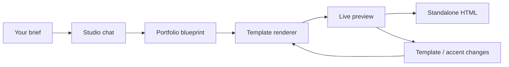

<div align="center">


# Portfolio Studio

**Turn who you are into a portfolio worth sending.**

A Claude-style studio that interviews you, art-directs the result, and hands you a portfolio you own.
Ten cinematic templates, a live desktop + mobile preview, and one-file HTML export.

[**Live demo**](https://site-12814198e9224ea9861b511f69be1706.freebuff.page) · [Features](#the-studio) · [Templates](#ten-templates-one-blueprint) · [Quick start](#quick-start) · [Deploy](#build-and-deploy)

[](https://site-12814198e9224ea9861b511f69be1706.freebuff.page)
[](https://github.com/uchejerla/portfolio-llm-project/actions/workflows/ci.yml)
[](https://react.dev)
[](https://www.typescriptlang.org)
[](https://workers.cloudflare.com)

</div>

---

> **Try it now:** [open the live studio](https://site-12814198e9224ea9861b511f69be1706.freebuff.page). The public demo is running without a model key, so you can explore the complete interface in **local draft mode**. Add your own Claude or OpenAI key to unlock free-form writing and revisions.

## Why this exists

Most portfolio builders start with a grid and a template. This one starts with a conversation.

Tell the studio who you are, what you make, and which work matters. It writes a point of view, structures your projects, and renders a finished site — then lets you change the look without rewriting a word. No page builder, no blank canvas, no lorem ipsum.

- **Designed, not generated.** Every template is a hand-built front-end with its own type system, layout, motion, and poster art.
- **Your copy stays yours.** The model returns a structured blueprint, not raw HTML. Switching from Cinema to Atelier keeps every word in place.
- **Works without a key.** The local draft engine gets you from a brief to a real starter portfolio; Claude takes it further.
- **A site you own.** Export one standalone HTML file and put it anywhere.

## The studio

Chat on the left. The portfolio assembles on the right.


The studio combines a conversational editor with a live artifact panel:

**Conversation**
- Streaming replies, markdown, stop generation, and a thinking state
- Conversation history, local search, and `⌘K` for a new chat
- Four sample briefs and a fill-in-the-blanks story scaffold
- Attach briefs or résumés as `.txt`, `.md`, `.json`, or `.csv` files
- Light and dark themes, responsive layouts, and saved conversations

**Studio**
- Desktop and phone previews that update as the portfolio changes
- Ten templates in a single click, plus a visual lookbook
- Six curated accent colours and a custom colour picker
- Copy the blueprint JSON, open the export in a new tab, or download it
- Ten templates share one content model, so nothing gets lost when you change your mind

**Under the hood**
- Anthropic Claude streaming via the Messages API
- Any OpenAI-compatible chat completions endpoint as an alternative
- Server-only model keys, with graceful local draft fallback
- A typed normalizer that makes every word of model output render-safe
- A Cloudflare Workers build of the same API for public hosting

## Ten templates, one blueprint

Every portfolio starts as a complete JSON blueprint: identity, hero, projects, about, skills, experience, contact, and links. The renderer turns that blueprint into one of ten art-directed systems.


| Template | Direction | Best for |
| --- | --- | --- |
| **Cinema** | Dark billboard, marquee, horizontal project rows | Filmmakers, motion designers, directors |
| **Noir** | High-contrast monochrome, filmic credits | Photography, editorial, moody personal work |
| **Editorial** | Warm paper, magazine masthead, numbered index | Writers, strategists, consultants |
| **Brutal** | Acid accents, hard rules, monospace labels | Brand designers, studios, culture-led work |
| **Gallery** | Quiet walls, captions, generous white space | Photographers, artists, architects |
| **Terminal** | Phosphor-green shell, command-line rhythm | Engineers, technical founders, developer tools |
| **Aurora** | Deep gradients, frosted glass, soft light | Product designers, AI, modern software |
| **Swiss** | Strict grid, Helvetica discipline, red accents | Designers, architects, typographers |
| **Kinetic** | Oversized type, poster energy, looping marquees | Creative studios, streetwear, culture |
| **Atelier** | Ivory, hairlines, italic serif, quiet luxury | Fashion, luxury, craft-led practices |

All ten are responsive and export with inline CSS, generated poster artwork, and a small scroll-reveal script. Exports load their display fonts from Google Fonts, with system fallbacks.

## Responsive by default

The studio is designed to be edited from a laptop and checked from a phone. The portfolio preview switches between a 1440px desktop canvas and a 390px phone without leaving the page.

<p align="center">
  
</p>

## How it works



1. **Talk.** Describe your practice, paste a résumé, or start from a sample brief. The studio asks only for what it needs.
2. **Structure.** The model returns a complete blueprint: a headline with a point of view, concretely written projects, an about section, links, and a clear call to action.
3. **Art-direct.** Pick a template and an accent. The same words are re-rendered instantly, so comparing looks costs nothing.
4. **Ship.** Export a single HTML file, copy the blueprint, or open the finished site and keep editing.

The blueprint is normalized on the server and again in the browser. Unknown fields, oversized strings, unsafe URLs, and malformed model output are dropped or repaired before anything renders.

## Quick start

**Requirements:** Node.js 20+ and npm.

```bash
git clone https://github.com/uchejerla/portfolio-llm-project.git
cd portfolio-llm-project
npm install
npm run dev
```

Open **http://localhost:3000**.

That is enough to try the whole product. Without a model key the status pill reads **Local draft** and the local engine builds a starter portfolio from your brief.

## Connect a model

Create a `.env` file and add an Anthropic key:

```bash
cp .env.example .env
```

```dotenv
ANTHROPIC_API_KEY=your_key_here
ANTHROPIC_MODEL=claude-sonnet-4-5
```

Restart `npm run dev`. The status chip switches to Claude and replies become fully generated.

To use an OpenAI-compatible endpoint instead:

```dotenv
OPENAI_API_KEY=your_key_here
OPENAI_BASE_URL=https://api.openai.com/v1
OPENAI_MODEL=gpt-4.1-mini
```

Anthropic is used when both are configured. Keys are read only by the server; they are never sent to the browser, included in chat storage, or committed. `.env` is gitignored.

Without a key, **local draft mode** can assemble a starter portfolio, extract projects from a brief, change templates and colours, and update your details. It cannot rewrite prose.

## Build and deploy

### Node

```bash
npm run build
PORT=3000 npm start
```

The Express server serves the built app and the API from one process.

### Cloudflare Workers

The same API is available as a Worker, with the Vite build as static assets:

```bash
npm run build:sites
npx wrangler dev --config wrangler.jsonc
```

- `worker/index.ts` — the Workers API and static asset router
- `sites.manifest.json` — the deployment manifest for Freebuff Sites
- `wrangler.jsonc` — a local workerd preview that mirrors the hosted setup
- `sites-build/worker.js` — generated by `npm run build:sites` (ignored by git)

The live demo above is deployed on Freebuff Sites.

> **Do not put a model key on a public URL without access control.** Anyone with the link could generate portfolios on your account. Keep a public demo in local draft mode, or add authentication and rate limiting before connecting a key.

## Project map

```text
src/
  App.tsx                 state, streaming, persistence, export
  components/             sidebar, chat, studio, lookbook, settings
  portfolio/
    types.ts              blueprint types
    normalize.ts          input validation and repair
    render.ts             template registry and document shell
    templates/            ten hand-built renderers + shared toolkit
  lib/                    API client, storage, sample briefs
server/
  index.ts                Express API and SSE transport
  prompt.ts               system prompt and blueprint-aware history
  providers.ts            Anthropic / OpenAI-compatible adapters
  offline.ts              local draft engine
  parse.ts                message and blueprint extraction
worker/
  index.ts                Workers API and static asset router
public/
  fonts/                  self-hosted interface fonts and licenses
```

## API

Both the Express server and the Worker expose the same two endpoints.

```http
GET /api/status
```

Returns the active provider, model, and readiness. No credentials are included.

```http
POST /api/chat
Content-Type: application/json

{ "messages": [{ "role": "user", "content": "..." }], "portfolio": null }
```

Responds with `text/event-stream`:

| Event | Payload |
| --- | --- |
| `text` | `{ "text": "..." }` — the visible reply so far |
| `portfolio` | `{ "portfolio": { ... } }` — the normalized blueprint |
| `done` | `{ "message": "...", "portfolio": { ... } }` |
| `error` | `{ "message": "..." }` |

## Scripts

| Command | What it does |
| --- | --- |
| `npm run dev` | Vite app + Express API with live reload |
| `npm run typecheck` | TypeScript across the app, server, and Worker |
| `npm run build` | Typecheck and build the SPA into `dist/` |
| `npm run build:sites` | Build the app and bundle the deployable Worker |
| `npm run start` | Serve the production build and API from Node |
| `npm run preview` | Preview the Vite build |

CI runs the typecheck, app build, and Worker build on every push and pull request.

## FAQ

**Do I need an API key?**
No. Local draft mode is enough to try the full flow and export a starter portfolio. A key unlocks model-written copy and real revisions.

**Where is my data stored?**
Chats and blueprints live in your browser's `localStorage`. There is no database and no account. Clearing site data clears the studio.

**Can I host the export anywhere?**
Yes. Export is a single HTML file with inline CSS. Upload it to any static host, or open it directly from disk.

**Why does the live demo say Local draft?**
It is deliberately running without a model key so the public demo can be shared without spending API credits. Your own deployment can connect a key in its server environment.

**Can I add another template?**
Yes. Add a renderer under `src/portfolio/templates/`, register it in `meta.ts` and `render.ts`, and it will appear in the studio and the model's template guide. Each template is plain TypeScript that returns an HTML document.

**Is this affiliated with Netflix or Anthropic?**
No. Cinema is inspired by cinematic streaming interfaces; the project is independent and uses the Anthropic API only when you configure a key.

## Contributing

Issues and pull requests are welcome. For a change that affects the UI, include a screenshot at desktop and phone widths. Before opening a PR:

```bash
npm ci
npm run typecheck
npm run build:sites
```

Keep model keys out of commits, fixtures, screenshots, and logs.

## Acknowledgements

Interface and portfolio typography use **Inter**, **Instrument Serif**, and **JetBrains Mono**, all under the SIL Open Font License. Font licenses live in [`public/fonts/`](public/fonts/).

Built with React, Vite, TypeScript, Express, and Cloudflare Workers. The Cinema template is a love letter to title sequences and streaming interfaces — no affiliation implied.

---

<p align="center">
  <sub>If Portfolio Studio helps you ship the portfolio you keep putting off, a star helps more people find it.</sub>
</p>
